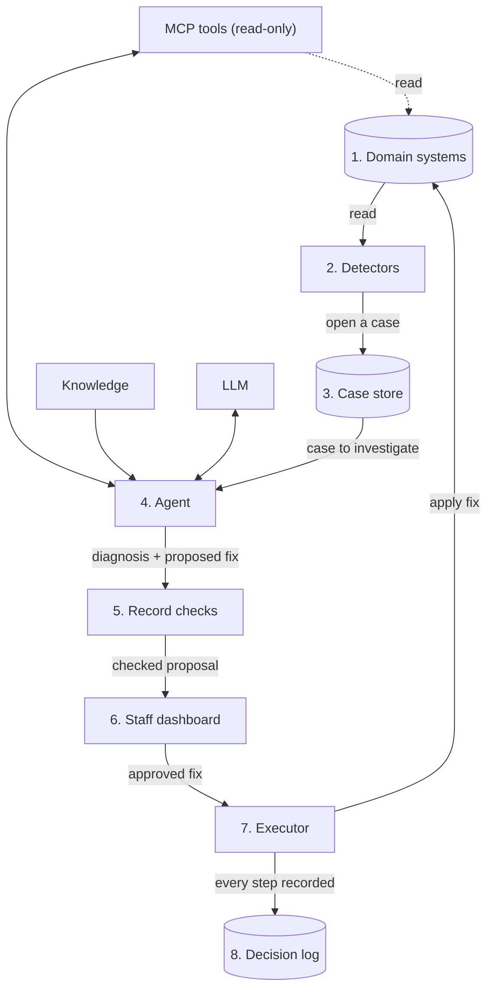
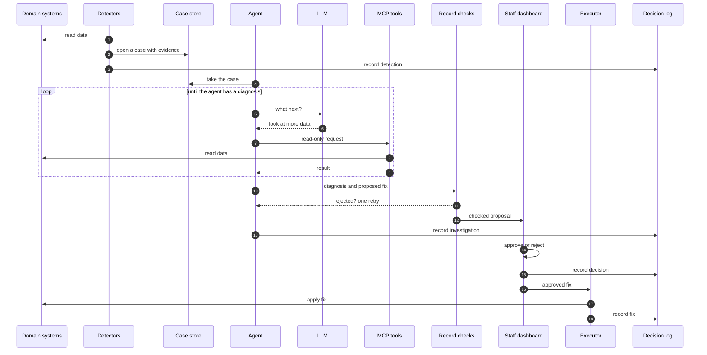

# registries-case-manager: Architecture diagram

1. **Domain systems** hold the data: databases, files and logs.
2. **Detectors** read that data and find something wrong.
3. The **case store** keeps one case per problem, with its evidence.
4. The **agent** investigates the case. It uses the domain's **knowledge**, the **LLM**, and read-only
   **MCP tools** to look at more data.
5. **Record checks** make sure every claim in the diagnosis is backed by evidence.
6. **Staff** approve or reject the proposed fix on the **dashboard**.
7. The **executor** applies approved fixes. It is the only part that writes.
8. The **decision log** records every step, from detection to fix.

## Sequence

The same flow, step by step in time.

