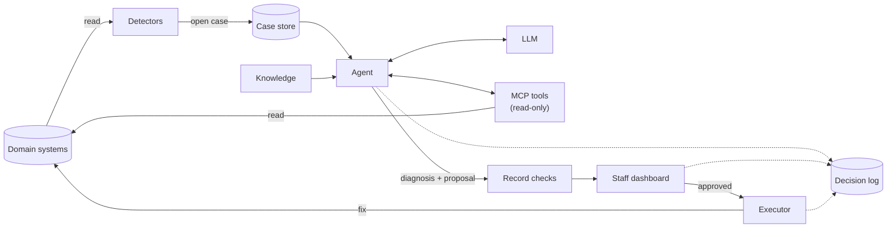

# registries-case-manager: Architecture diagram

The main components and how a case flows through them. Details are in [design.md](design.md).

1. **Detectors** find something wrong and open a **case**.
2. The **agent** investigates it, using the **LLM**, read-only **tools** and the domain's **knowledge**.
3. **Record checks** make sure every claim is backed by evidence.
4. **Staff** approve or reject the proposed fix on the **dashboard**.
5. The **executor** applies approved fixes. It is the only part that writes.
6. Every step is recorded in the **decision log**.
